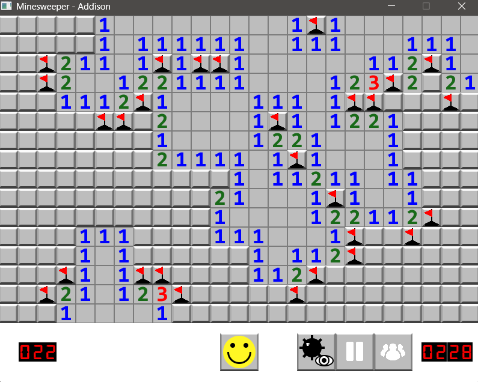

# Hi there 👋, I'm Addie!

## Featured Project

### [RDR2 Poker Advisor](https://github.com/addiegregory/RDR2-Poker-Advisor)

Developed a Python-based poker decision-support system using **Monte Carlo simulation, probability, and expected-value analysis** to generate explainable strategy recommendations for *Red Dead Redemption 2*.

- Implemented Monte Carlo simulations to estimate win probability, hand equity, and outcomes against randomized opponents.
- Developed a five- to seven-card hand-evaluation algorithm with hand ranking, tie-breaking, and optimal combination selection.
- Built a modular, object-oriented system integrating pot-odds calculations, stack-aware decision logic, input validation, and automated unit testing.

#### Future Development

Expanding the application into a real-time, AI-powered poker advisor by integrating computer vision for automatic card recognition from gameplay screenshots, machine learning for strategy optimization, and an in-game overlay for live decision support.

## Other Projects

### Minesweeper

Developed a graphical Minesweeper application in **C++17 and SFML 3**, implementing randomized board generation, interactive gameplay, real-time timers, and persistent leaderboard tracking.

- Designed a modular, object-oriented architecture with separate `Board`, `Tile`, and `Leaderboard` components to manage game logic and state.
- Implemented an iterative flood-fill algorithm for revealing connected tiles and used `std::mt19937` with `std::shuffle` for randomized mine placement.
- Built an event-driven graphical interface using SFML for mouse input, sprite rendering, and pause/resume functionality.
- Implemented file I/O, score sorting, and ranking algorithms to maintain a persistent top-five leaderboard.

  

*Source code is private due to course repository restrictions.*

### TGA Image Processor

A C++ command-line application that reads and writes binary TGA images. It supports image blending, color-channel adjustments, and 180° rotation, and allows users to chain multiple operations in a single command.

*Source code is private due to course repository restrictions.*

### Sudoku Game

An interactive Pygame application developed collaboratively by a four-person team using Python. It generates random puzzles with three difficulty levels and includes keyboard navigation, number sketching, reset controls, and automatic solution validation.

*Source code is private due to course repository restrictions.*

### More Projects

View my complete [Python Projects](https://github.com/stars/addiegregory/lists/python-projects) and [C++ Projects](https://github.com/stars/addiegregory/lists/c-projects) lists.
